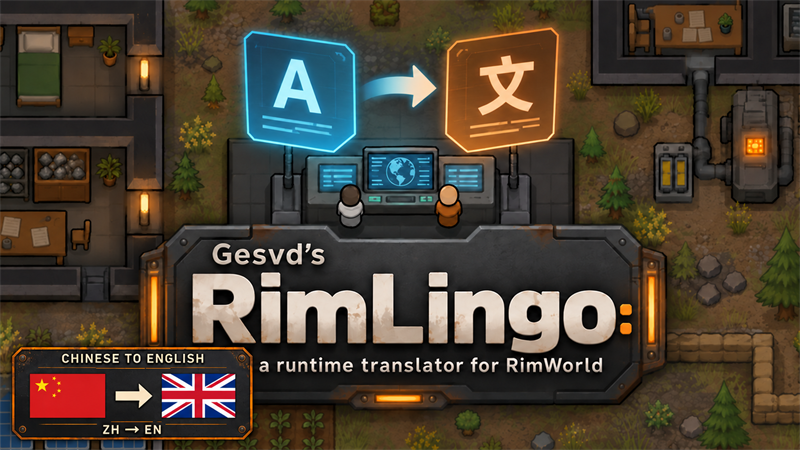
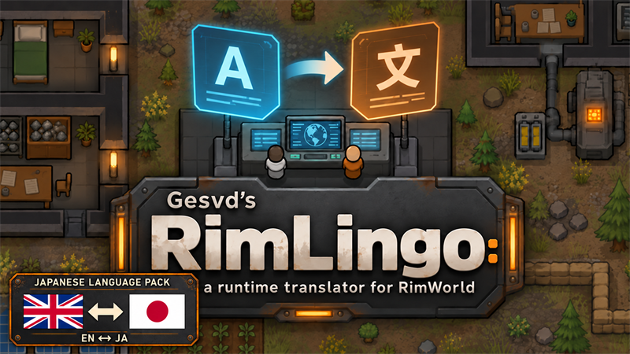
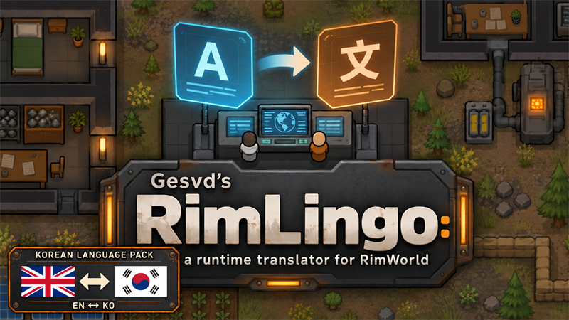
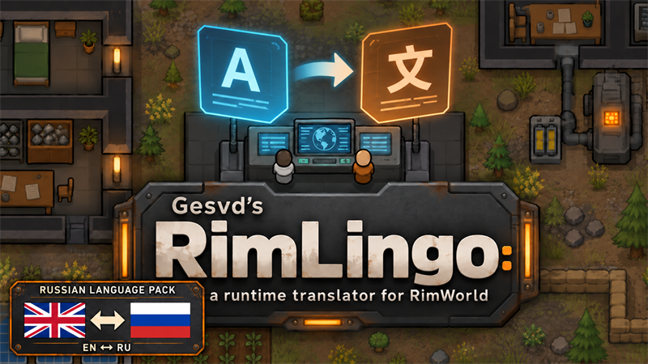
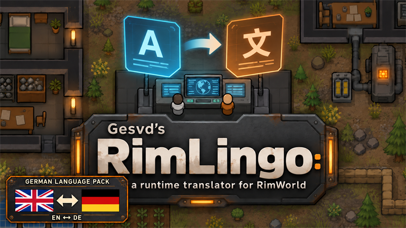
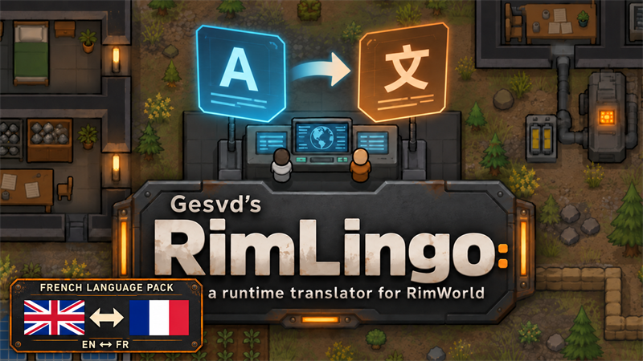
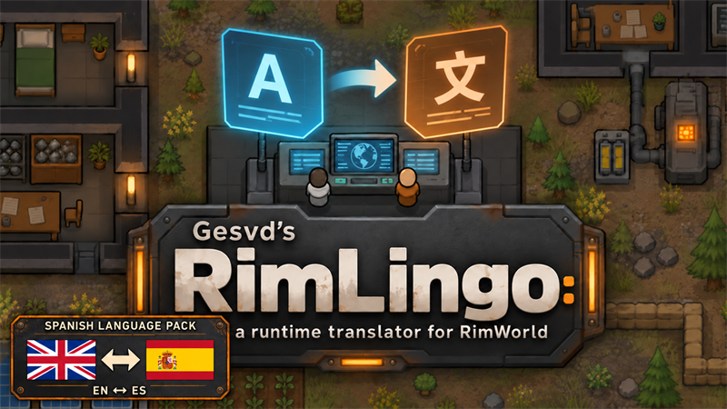
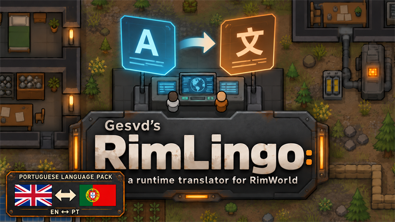

# RimLingo v1.3.0 — Language expansion covers

Generated and edited with the built-in image_gen tool on 2026-10-22, using the existing RimLingo cover as the visual reference. The original base artwork remains unchanged. Each expansion has a bottom-left plate with national flag icons, a direction arrow, an English pack title and compact language codes for international readers.

High-resolution generated originals are `<Language>.png`. Workshop/mod exports are `<Language>-Preview.png` (800×450 opaque PNG, below 1 MiB), copied into the corresponding expansion’s `About/Preview.png`. Only resizing/export was done after generation; flags, lettering and illustration were produced by image_gen. No official RimWorld logo was used.

The cover direction is the installed model direction, not every possible pivot route. ChineseSimplified adds ZH → EN; EN → ZH is in the base mod. Other packs provide English in both directions. English uses the UK flag; Portuguese uses the Portugal flag. Codes clarify the language independently of the flag shorthand.

| Pack | Model direction | Flag icons | Codes |
|---|---|---|---|
| ChineseSimplified | Chinese → English | China → United Kingdom | ZH → EN |
| Japanese | English ↔ Japanese | United Kingdom ↔ Japan | EN ↔ JA |
| Korean | English ↔ Korean | United Kingdom ↔ South Korea | EN ↔ KO |
| Russian | English ↔ Russian | United Kingdom ↔ Russia | EN ↔ RU |
| German | English ↔ German | United Kingdom ↔ Germany | EN ↔ DE |
| French | English ↔ French | United Kingdom ↔ France | EN ↔ FR |
| Spanish | English ↔ Spanish | United Kingdom ↔ Spain | EN ↔ ES |
| Portuguese | English ↔ Portuguese | United Kingdom ↔ Portugal | EN ↔ PT |

## Generation/edit specification

Preserve the existing RimLingo colony scene, huge brand title, Gesvd’s name and full subtitle. Use the same compact charcoal-steel bottom-left identification plate with a thin orange outline for every variant. Replace only its English language-pack header, accurate flat rectangular flag icons, arrow and code footer. Use a one-way right arrow for ZH → EN and bidirectional arrows for all other packs. Keep all original branding visible and generate a finished opaque landscape PNG without extra text or official logos. The final Korean variant served as the shared plate-layout reference for the other flag variants.

## Preview gallery

### Chinese → English

[Full-resolution PNG](ChineseSimplified.png)

### English ↔ Japanese

[Full-resolution PNG](Japanese.png)

### English ↔ Korean

[Full-resolution PNG](Korean.png)

### English ↔ Russian

[Full-resolution PNG](Russian.png)

### English ↔ German

[Full-resolution PNG](German.png)

### English ↔ French

[Full-resolution PNG](French.png)

### English ↔ Spanish

[Full-resolution PNG](Spanish.png)

### English ↔ Portuguese

[Full-resolution PNG](Portuguese.png)
