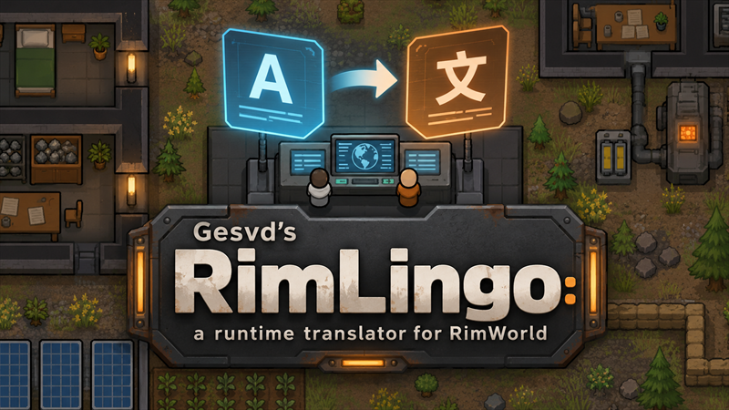

# Gesvd’s RimLingo: a runtime translator for RimWorld



Authors: Gesvd & Codex.

作者：Gesvd & Codex。以下为中文使用说明，后面保留英文说明和接口细节。

## 中文使用说明

Gesvd’s RimLingo 是一个在 RimWorld 游戏内运行的模组翻译器。玩家可以选择已加载的模组，通过内置离线引擎或自己配置的翻译 API 补充翻译，并用词汇库统一术语、手动修改结果。它不会在游戏启动时自动联网或开始翻译任务。

### 安装与首次使用

1. 下载完整安装包 **`Gesvds-RimLingo-LibreTranslate-win64.zip`**。GitHub 的 **Code → Download ZIP** 是源码包，不含大型离线运行文件；普通玩家应使用完整安装包，无需自行编译 DLL。
2. 手动安装时，将解压出来的 **`RimLingo` 文件夹**放入 RimWorld 的 `Mods` 目录。进入该文件夹后，应直接看到 `About`、`Assemblies`、`Languages` 和 `LocalEngine`，不要再多套一层目录。
3. 在游戏模组列表中启用 **Gesvd’s RimLingo: a runtime translator for RimWorld**，按游戏提示重新加载。
4. 打开 **选项 → 模组设置 → Gesvd’s RimLingo**。`Task` 是任务页，`Mods` 是模组选择页，`Provider` 是翻译服务页，`Preview` 是译文预览页，`Status` 是状态页，`Glossary` 是词汇库页。
5. 在模组页勾选要处理的模组，在任务页填写源语言和目标语言，在服务页选择翻译方式，再点击开始。任务可以暂停、继续或取消。

发布到 Steam 创意工坊时，作者应上传完整包解压后的 `RimLingo` 模组目录，并保留许可及源码资料。正确上传完整目录后，订阅玩家无需再手动解压。

### 使用内置离线翻译

完整包已包含 LibreTranslate、独立 Python 运行时和英中模型。**玩家不需要另装 LibreTranslate、Python 或 Docker，也不需要 API Key，运行时可以断网。**

在 `Provider` 页选择 **LibreTranslate**，勾选 **Use bundled offline engine (Windows, English to Chinese)**。源语言填 `English`，目标语言填 `ChineseSimplified`。第一次发起翻译时会在后台加载模型，只监听本机回环地址；退出游戏时会停止引擎进程。

当前内置引擎仅支持 **Windows x64、英文 → 简体中文**。其他语言或翻译服务可以使用 OpenAI 兼容 API、外部 LibreTranslate，或已配置好的 Lara SDK 本地桥接。详细的离线包说明和日志位置见 [LocalEngine/README.md](LocalEngine/README.md)。

### 自带译文优先、DLC 排除与跳过选项

**已有的有效目标语言译文始终优先，翻译器只补缺失文本。** 对于支持的文本字段，作者自带译文以及游戏已加载的独立汉化模组译文，不会被机器翻译、旧缓存、预览手动替换或生成的导出条目覆盖。

RimWorld 本体和官方 DLC 不会出现在可选模组中，也不会进入翻译或词汇扫描；旧设置中残留的官方内容选择会被清理。

任务页默认开启 **Skip mods with bundled Chinese translations (entire mod, even if partial)**，即“跳过自带中文的整个模组”。识别当前有效版本目录中的标准中文 Keyed/DefInjected XML，空目录、空白和 TODO 文件不会单独触发跳过；简体与繁体分别识别。

如果某个模组只有部分汉化，可以关闭这个选项来补齐缺失条目。**关闭整模组跳过，也不会覆盖已有译文。** 自带中文的模组仍能在模组页勾选，供词汇库导入使用。

另一个默认开启的选项 **Skip completed translations (reuse valid cache)** 用于复用已完成的有效缓存，减少重复请求。关闭后会重新翻译未受自带译文保护的条目，并可能替换已有自动或手动缓存结果。

### 扫描、导入和维护词汇库

词汇库用于统一 `pawn`、武器、建筑等词语的译法。默认已有 `pawn` / `pawns` → “小人”，玩家可以修改。建议先整理词汇库，再开始正文翻译。

- **扫描常见英文词**：选好模组，进入 `Glossary` 页，点击 **Scan selected mods (English candidates)**。它扫描模组英文文件，过滤常见介词、连词及格式变量，把至少出现两次的词加入候选。空白译法不会参与替换。
- **导入模组自带中文术语**：源语言设为 `English` 或 `Auto`，目标设为对应的简体或繁体中文，点击 **Import glossary from selected mods with bundled Chinese translations**。此功能本地运行，不调用 API；按相同 XML 键配对英文与中文，提取短词或短语。
- **翻译缺少译法的词条**：点击 **Translate missing glossary terms (current provider)**，使用当前选择的翻译服务处理空白词条。已有译法会保留。
- **手动维护**：搜索词条、修改译法，或使用 **Add / update term** 添加词和短语。清空译法表示停用该条规则，**Remove** 可以删除词条。

自带术语导入只添加新词或填补空白，不覆盖默认词条或玩家已有译法；同一英文出现不同中文译法时不自动导入。简繁体不会混合。导入的短语最多六个英文单词、64 个字符，不从长句中猜测单个单词的对应关系，也不提取只有继承结果而无匹配源文件的标签、非 XML Strings 或缺少对应英文文件的独立汉化包。

词汇修改影响后续新任务；已开始的正文任务保持启动时的语言、服务和词汇规则。**Batch size (next request)** 是实时设置，修改后从下一批请求生效，已经发送的请求不会被拆分。

### 原文保留、缓存与导出

译文的标签、变量和格式占位符会被保护；缺失或重复占位符的响应会被拒绝。请求失败、结果缺失、纯空白、零宽字符或空格式标签不会作为正常译文覆盖游戏文本。明确的 API 过滤或拒译响应会记录为失败，保留已有文本。翻译器自身不进行内容消音，但无法保证外部服务不会拒译或返回非空的错误译文。

可以在 `Preview` 页查看和修改缓存译文；清空自动译文会恢复原始文本。已有自带译文仍受优先级保护。缓存位于 RimWorld 配置目录的 `RuntimeTranslator/cache.xml`，保存时保留备份，取消任务不会清空已经保存的结果。

开启导出后，会在配置目录的 `RuntimeTranslator/GeneratedLanguages/<目标语言>/` 下生成标准语言 XML。导出会排除与已有自带译文冲突的条目，并更新或清理自己生成的 `RuntimeTranslator.xml`；手动维护的文件应使用其他名称。生成目录不是自动启用的独立汉化模组，按需复制到合适的语言目录或自行整理为汉化模组。

退出游戏会中断请求和后台任务；已经保存的批次保留，退出前尚未保存的部分可能需要重新翻译。

### 当前范围与验证情况

目前主要处理已加载 Def 的 `label`、`description`、`jobString`、`deathMessage`、`gerund` 和 `reportString`，以及本模组自身的 Keyed 设置界面。它还不能覆盖其他模组所有硬编码界面、动态生成文本或所有 Keyed 调用。

当前版本已通过编译和自动回归检查，但仍需在实际游戏及具体模组组合中验证。翻译质量需要玩家校对，内置离线引擎对被标签、术语分割的句子和英文缩写可能处理得不够自然。

### 我们的代码与第三方许可

我们编写的模组主体、测试及构建工具采用 **GPL-3.0-only**，C# 模组附有范围有限的 [RimWorld/Unity 链接例外](LICENSE-EXCEPTION.md)。**LibreTranslate 保持 AGPL-3.0，本地服务集成 `LocalEngine/serve.py` 采用 AGPL-3.0-only**；模型、Python 和其他依赖保留各自许可与署名。

分发时应保留许可证、署名和与二进制匹配的对应源码资料。具体范围见 [LICENSING.md](LICENSING.md)，第三方组件及模型来源见 [THIRD_PARTY_NOTICES.md](LocalEngine/THIRD_PARTY_NOTICES.md)。

---

## English Guide

Gesvd’s RimLingo is a RimWorld internal mod prototype that translates loaded mods from an in-game settings panel.

It is intentionally idle at startup: it loads settings and cache metadata only. Network connections and text scanning start after the player presses **Start translation**.

## Current Scope

- In-game mod settings window.
- Select loaded mods for translation.
- Choose source and target language.
- Choose provider:
  - OpenAI-compatible chat/completions API.
  - LibreTranslate-compatible HTTP API.
  - Lara Translate SDK bridge.
- Start, pause, resume, and cancel background translation.
- Cache translated entries under RimWorld's config folder.
- Apply common `Def.label` and `Def.description` translations at runtime.
- Export translated entries as standard RimWorld `Languages/<Target>/DefInjected/...` XML files.

## Use In Game

1. Build the DLL into `Assemblies/RuntimeTranslator.dll`.
2. Place this folder under RimWorld's `Mods` directory.
3. Enable **Gesvd’s RimLingo: a runtime translator for RimWorld** in RimWorld's mod list.
4. Start RimWorld normally. The mod stays idle during startup.
5. Open **Options > Mod Settings > Gesvd’s RimLingo**.
6. Choose provider settings, target language, and the loaded mods to translate.
7. Press **Start**. Use **Pause**, **Resume**, or **Cancel** as needed.

Each task keeps the language, provider, glossary, skip-completed choice, and apply/export settings it had when **Start** was pressed. Changes to those settings affect the next task. **Batch size** is live: the next batch uses the current value, including after resuming a paused task; an already-sent request keeps its original size. Manual preview edits use the current apply setting.

**Skip completed translations** is enabled by default. It excludes valid completed entries from API requests and from the pending task total, while applying cached results to the game. The status shows the skipped count separately. Valid cached results can be reused across providers; the selected provider is preferred, otherwise the latest available record is used. Cleared preferred records, changed source text, and changed applicable glossary rules still need translation. Turning this option off retranslates all selected entries and can overwrite earlier automatic or manual translations.

Runtime translations continue to apply on the main thread after the settings window is closed, up to 20 entries per frame. Original field text is retained for this game session, so restarting a task does not translate an earlier translation. Clearing a preview translation restores the original field text and allows that entry to be translated again.

Cache saves first write a temporary file, then replace `cache.xml` while retaining the previous version as `cache.xml.bak`. A damaged or missing primary cache can load the backup. Save failures appear in the status/log and preserve the previous cache file.

Exports include only the chosen target language. For each Mod/Def/field, the most recently updated cached version wins across providers and source versions; a cleared latest version suppresses older translations. Export overwrites its own `RuntimeTranslator.xml` files and removes stale files of that name under the selected language's generated `DefInjected` folders. Put hand-maintained translations in separate files or folders.

Provider responses with missing, repeated, or unknown protected placeholders are rejected rather than cached. Previously saved translations are not automatically repaired.

Cancelled tasks finish with `Cancelled`, including cancellation before a request starts or while paused. Unexpected task errors finish with `Failed` and retain the error message. Results already completed before cancellation remain in the cache.

Preview's **Replace next 50** processes each matching record once per operation, even when the replacement contains the search text. The remaining count excludes processed records. Changing the search/replace fields or starting a translation task begins a new replacement operation; manually editing a record allows that record to be replaced again.

## Translating This Mod

Gesvd’s RimLingo now appears in its own **Mods** list. Select it and start a translation task to translate the settings interface. The English UI table is in `Languages/English/Keyed/RuntimeTranslator.xml`; its 95 entries support runtime editing/caching and standard `Keyed` export. Its source table remains English even after the interface is translated. Game/provider IDs and diagnostic log messages are not all localized.

## Interrupting Work On Exit

The mod hooks Unity's early quit request, application quit, and updater destruction. A shared cancellation signal stops main translation requests, glossary translation, glossary file scanning, and automatic export. Queued UI actions and runtime writes are discarded once shutdown starts. Shutdown never joins worker tasks or waits for the cache lock; auto-export uses a cache snapshot rather than holding that lock during file I/O.

Previously saved batches remain on disk, protected by temporary-file replacement and backup. A batch that has not yet been saved at the moment of exit may need to be translated again. This mechanism has regression coverage with active requests and a busy cache lock; actual RimWorld/OS shutdown still needs an in-game check.

## Glossary

1. Choose mods on **Mods** and the source/target languages on **Task**.
2. Open **Glossary** and press **Scan selected mods**. Discovery runs in the background without API calls or changes to mod files.
3. Review candidates by occurrence count, search them, and enter preferred translations. Words occurring at least twice are added; blank translations remain inactive. Existing choices survive rescans.
4. Press **Translate missing glossary terms (current provider)** to translate all blank terms for the current language pair, including those outside the current search/page. It uses the configured provider and the live batch size. Already populated terms are preserved, including manual corrections and the built-in pawn defaults. Each successful batch is saved; failed terms remain blank and retryable. A separate cancel button stops this job. Review the generated wording before starting the main translation task.
5. Use **New word / phrase** to add terms not discovered by the scan. Existing rows can be edited or removed. Results are paged at 30 rows to keep the editor responsive.
6. Start a translation task. The glossary is frozen with the task's settings. Edited terms cause matching source texts to be translated again on the next task; unrelated cached translations remain usable.

English-to-Simplified-Chinese starts with `pawn` and `pawns` mapped to `小人`. Both entries can be changed, for example to `角色`. Other language pairs have independent terms. English source aliases and Auto use the English glossary. Automatic discovery currently supports English; other languages can use manually entered terms.

Discovery reads common text fields in the active mod version's `Defs` XML and leaf text in `Languages/English` XML. It excludes English stop words, formatting tokens, IDs, and non-English language files. Malformed or unreadable XML files are skipped with a log warning. Counts are for the selected files, not an exhaustive linguistic analysis; singular/plural forms are separate editable terms.

All three providers protect confirmed terms as placeholders and restore the exact preferred wording. Matching ignores case, uses whole-word boundaries, and prioritizes longer phrases. Format tags and variables remain protected. A provider that damages these placeholders fails the batch rather than storing inconsistent terms. A word with several meanings uses the same preferred wording throughout the language pair; clear or remove a term if that is unsuitable.

Terms are saved in RimWorld mod settings, including on scan completion, adding a term, or each automatic glossary translation batch; inline edits are saved when the settings window closes. The original mod files remain unchanged. Previously generated files are refreshed by exporting again after the new translation task completes.

## Build

Install a .NET SDK that can target .NET Framework 4.7.2, then build with a RimWorld managed assembly path:

```powershell
dotnet build .\RuntimeTranslator.csproj -p:RimWorldManagedDir="C:\Program Files (x86)\Steam\steamapps\common\RimWorld\RimWorldWin64_Data\Managed"
```

The DLL is emitted to `Assemblies/RuntimeTranslator.dll`.

## Regression Checks

Run with PowerShell 7:

```powershell
pwsh -NoProfile -File .\Tests\Run.ps1
```

These checks compile the real translation/cache/provider code with small game API stand-ins. They use temporary files and no network requests. They do not replace an in-game test of Unity's update lifecycle or live provider compatibility.

## Provider Notes

The OpenAI-compatible provider accepts services that expose `/chat/completions`, including many hosted APIs and local tools such as LM Studio.

Its prompt sends a JSON array of `{ "id": "...", "text": "..." }` items and requests the same structure back with translated text. JSON strings preserve paragraph breaks, quotes, and other special characters. Missing, duplicate, unknown, empty, or malformed results fail the batch rather than being partly cached. A surrounding JSON code fence is accepted. Custom rules must preserve this response format; the earlier `ID|||translation` line format is no longer accepted.

The LibreTranslate provider accepts `/translate` endpoints.

The Lara provider follows Lara's official SDK model through a local bridge service. Lara's docs recommend SDK usage and use Access Key ID + Access Key Secret credentials; the low-level REST API is not public by default. RimWorld mods target .NET Framework, while Lara's .NET SDK targets modern .NET, so the mod sends requests to a local bridge URL such as `http://127.0.0.1:8765/translate`.

Expected bridge request:

```json
{
  "text": "text to translate",
  "source": "en",
  "target": "zh-CN",
  "content_type": "text",
  "instructions": "preserve placeholders",
  "access_key_id": "your Lara access key id",
  "access_key_secret": "your Lara access key secret"
}
```

Expected bridge response:

```json
{
  "translatedText": "translated text"
}
```

API keys are stored in RimWorld mod settings. For public releases, prefer a local reverse proxy or a service-specific token with low quota.

## First Prototype Limits

This first version focuses on common loaded `Def` fields such as `label`, `description`, `jobString`, `deathMessage`, `gerund`, and `reportString`.

Apart from its own keyed settings interface, it does not yet patch every other mod's `Keyed` lookup or code-hardcoded UI string. Those need a second pass with targeted Harmony patches after the basic translation queue and cache are proven stable in game.

## Bundled offline translation

Windows x64 users can select LibreTranslate and enable **Use bundled offline engine (Windows, English to Chinese)**. The included engine runs independently on the local machine, uses the existing glossary and requires no API key or internet at runtime. Only English → ChineseSimplified is bundled. See [LocalEngine/README.md](LocalEngine/README.md) for packaging, rebuilding, logs, and [license/source obligations](LocalEngine/THIRD_PARTY_NOTICES.md).

## License / 许可证

我们编写的模组主体、测试及构建/打包工具采用 **GPL-3.0-only**；C# 模组附有允许与 RimWorld/Unity 程序集组合运行的有限[链接例外](LICENSE-EXCEPTION.md)。Copyright (c) 2026 Gesvd；项目作者为 Gesvd & Codex。

**LibreTranslate 保持 AGPL-3.0，我们的本地服务集成 `LocalEngine/serve.py` 采用 AGPL-3.0-only。** 模型、Python 和其他第三方组件保留各自许可，不受根目录 GPL 统一覆盖。分发时须保留适用声明并提供匹配的对应源码。GPL 允许商业使用，但分发修改版须履行其源码及相同许可要求。历史 MIT 副本的授权不被撤回。

完整范围说明见 [LICENSING.md](LICENSING.md)，GPL 全文见 [LICENSE](LICENSE)，第三方来源和模型署名见 [THIRD_PARTY_NOTICES.md](LocalEngine/THIRD_PARTY_NOTICES.md)。


## Official content and bundled Chinese translations

RimWorld Core and DLC are excluded using the game's official-content flag, both from mod selection and from translation/glossary scanning. Old saved selections cannot reintroduce them.

**Skip mods with bundled Chinese translations (entire mod, even if partial)** is enabled by default on the Task tab. For a Simplified/Traditional Chinese target, it skips a selected mod if the active content folders contain a matching Chinese Keyed or DefInjected XML entry with Chinese text. Empty directories, empty/TODO values and translations in inactive version folders do not trigger this check. Simplified Chinese and Traditional Chinese are checked separately. Other target languages are unaffected. Disable this option to fill missing text in mods with incomplete bundled Chinese catalogs; valid existing target-language entries remain protected. Skipped mods stay selectable so their existing translations can be imported into the glossary.

To reuse existing terminology, select the relevant mods on **Mods**, set English/Auto as source and the matching Chinese target, then open **Glossary** and press **Import glossary from selected mods with bundled Chinese translations**. Import runs locally without an API request. It pairs English/Chinese Keyed entries by key, and original Def labels with DefInjected `DefName.label` entries. It honors active folder precedence and never matches keys across different mods.

The importer adds short words/phrases (at most six words and 64 characters) or fills blank glossary translations. Existing defaults and manual translations are kept, and conflicting Chinese translations for the same English phrase are omitted. Imported terms remain editable/removable through the existing glossary UI. It does not infer individual word meanings from translated sentences; inherited-only labels, non-XML Strings and separate translation mods without matching source files are not imported.


## Native translation priority and text fallback

Existing target-language translations always take priority, including when **Skip mods with bundled Chinese translations** is disabled. Turning off whole-mod skipping allows missing entries to be translated; it does not authorize overwriting existing translations. Scanning and the worker exclude native entries, runtime application rejects conflicting cached/manual replacements, and export filters those entries out of its own generated files.

For the current game language, RimLingo snapshots the game's loaded Keyed and DefInjected tables, including separate translation mods and injections on base Def classes. For a different target language it reads the active mods' matching language XML instead. These indexes are prepared when needed for a task, preview application or export, with no new scan during game startup. A game-language object change rebuilds the snapshot; installing/changing mod files still requires the normal game reload. Native priority applies to the translator's supported fields and its own Keyed UI; it does not add translation hooks to every mod's hardcoded UI.

The translator keeps existing text when requests fail, results are missing, or a response contains only whitespace, zero-width format characters or empty markup. Clearing an automatic translation restores the original text rather than displaying an empty string. Explicit OpenAI-compatible `content_filter` and `message.refusal` responses fail the batch without becoming translations. Existing good translations and source text remain available. RimLingo does not perform content censorship; an external provider may still refuse or return an inaccurate nonempty translation, which cannot always be identified automatically.
